

# User's guide

The information screens of your centre, run from Moodle.

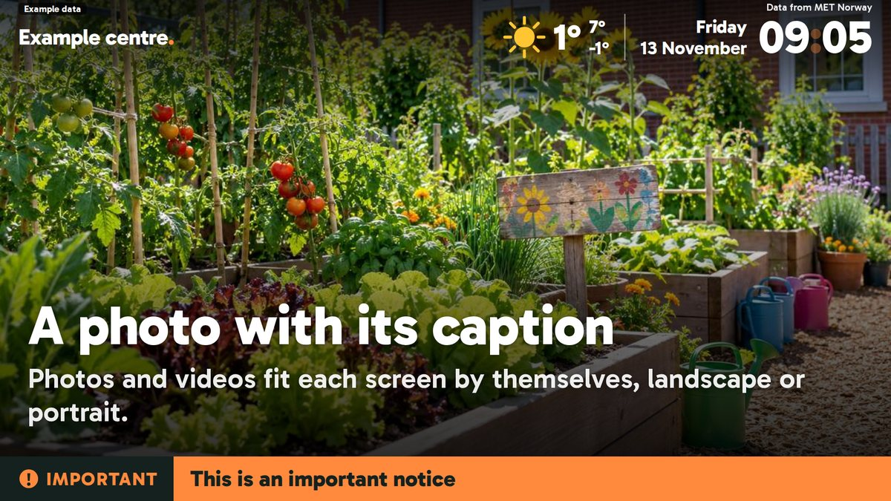

For whoever runs the screens and whoever publishes on them. With an example centre and example data.<b>oksigenia.com</b>

## What Hechauka is

Hechauka runs the information screens of a centre from its Moodle: notices, photos, videos, events, the menu of the day,
the agenda, the weather and whatever else is needed. Each screen shows it so that it can be read from afar, and it fills
itself with what Moodle already knows, even if nobody publishes anything.

This guide is for whoever runs the screens and whoever publishes on them. All the pictures are of an example centre,
with example data.

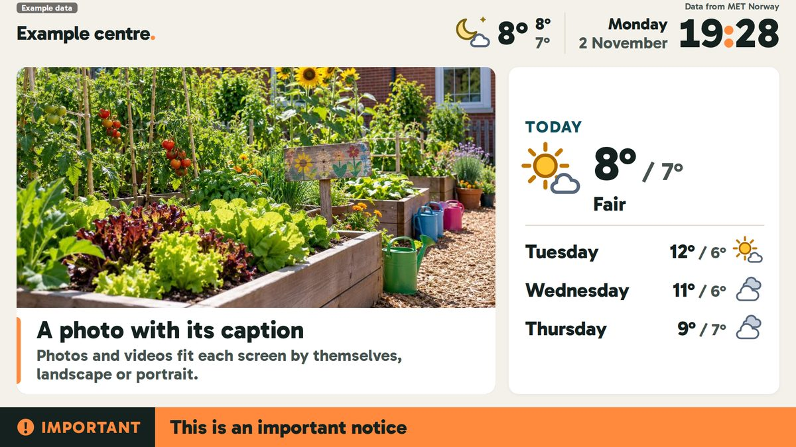

Hechauka works the same for a school, a university, an academy, a town council or a company: what changes is what each
one publishes.

## What you need

- **A Moodle**, version 4.5 or later, with the plugin installed. Whoever runs the Moodle installs it.
- **A screen with internet.** A television or a monitor with a browser will do, or any screen with a small device
  plugged in (a mini computer or a Raspberry Pi). The screen does not need to be on the same network as the Moodle: it
  only has to reach it over the internet. That is why a centre with several buildings, or with a camp in another town,
  runs everything from the same Moodle.
- **Someone to run the screens.** They do not need to be a Moodle administrator: the plugin brings its own permissions
  (further down, in [Who does what](#permisos)).

## The first time

The first time you go into «Screens», the panel welcomes you with **Get started**: five steps with the screen in sight,
changing as you choose.

1. **What your centre is.** A school, a university, an academy, an administration, a company or something else. It does
   not change what you can do; only what is suggested to begin with.
2. **Your brand.** The name, the logo and the colours are taken from your Moodle. You can change them.
3. **What comes by itself.** Which sources of your Moodle come out on the screens: the calendar, the news, the menu, the
   library, the deadlines. Each one says what it brings right now.
4. **Where the centre is.** For the weather on the screens.
5. **The first screen.** The address to open on the screen.

What you touch is saved by itself. You can leave it half done: the panel reminds you of what is missing.

### The example

A Moodle where Hechauka has just been installed brings an **example**: an important notice, notices, photos, an event,
a table and the ticker, and each piece explains what it does. That way neither the panel nor the first screen starts
empty. While any of the example is left, the screens say so with a small label, «Example data».

When you start with your own, press **Take the example out** in the panel. If you change a piece of the example, it stays
as yours.

## Setting up a screen

1. Open on the screen the address the panel gives (in «Get started», or in «Screens and groups» with **Add a screen**).
   The screen shows a code and a QR.
2. Scan the QR with your phone, or open the address shown on your phone and type the code.
3. Say whether **it is new** or **it replaces another** (if you have changed the television or the device, it keeps the
   name, the groups and what the old one showed). Give it a name that says where it is and, if you like, its groups.

In a few seconds the screen starts showing what is its. The code changes every few minutes: always use the one you see.

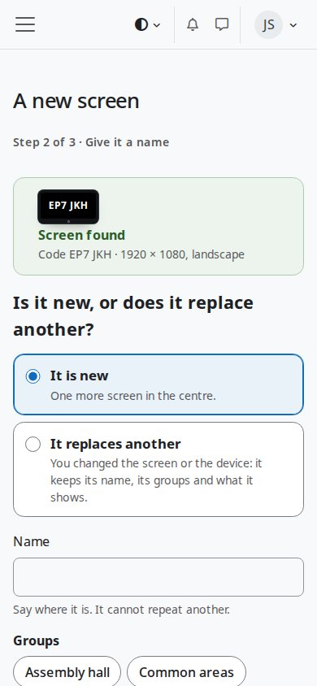

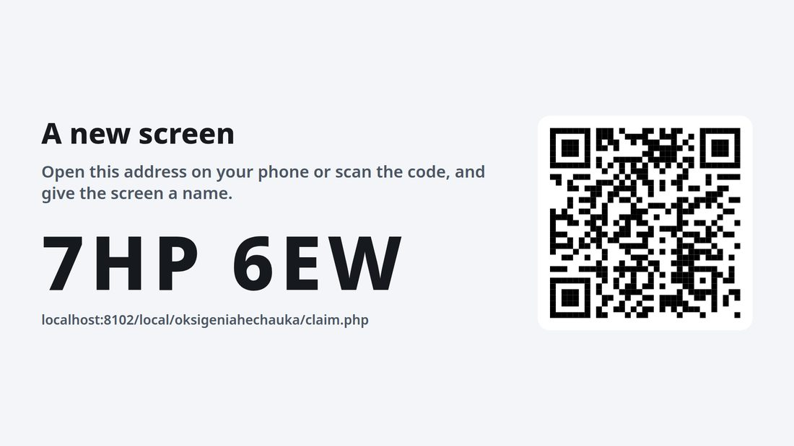

## What is on

The first tab of the panel shows each screen with what it has now, whether it is running and, below, everything
published: when it comes out and where. From there each thing is changed, hidden, duplicated or taken off.

On the phone, the same panel fits in one column.

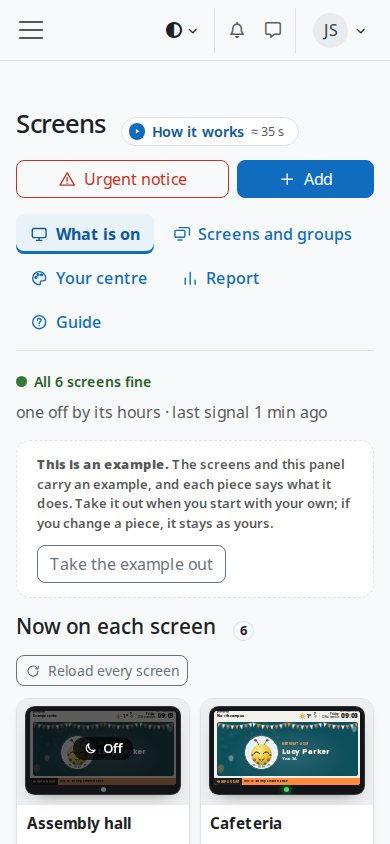

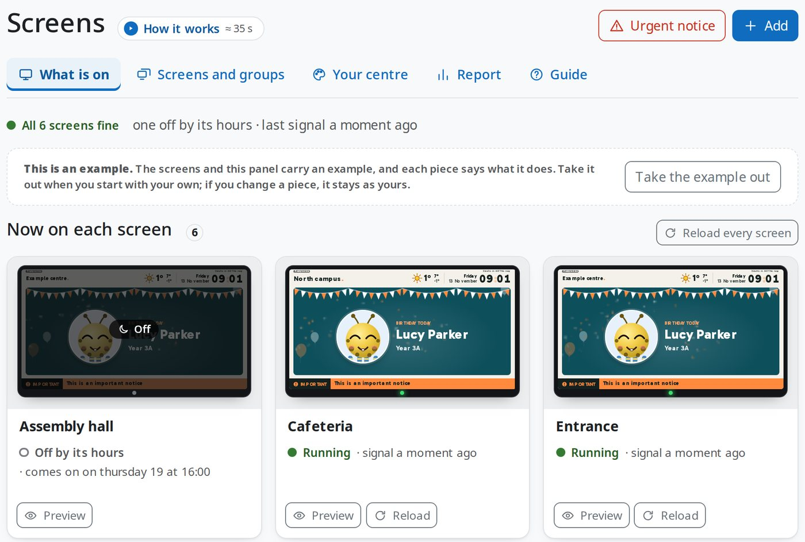

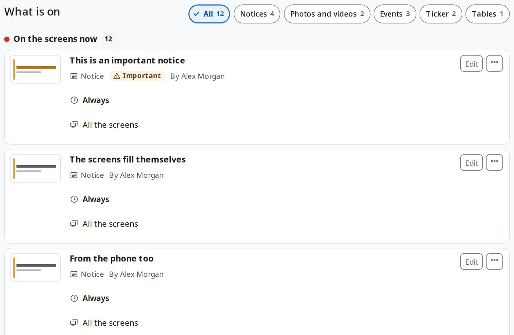

## Add

**Add** opens a form with the screen beside it: as you type, you see how it will look. At the top you choose the kind of
content.

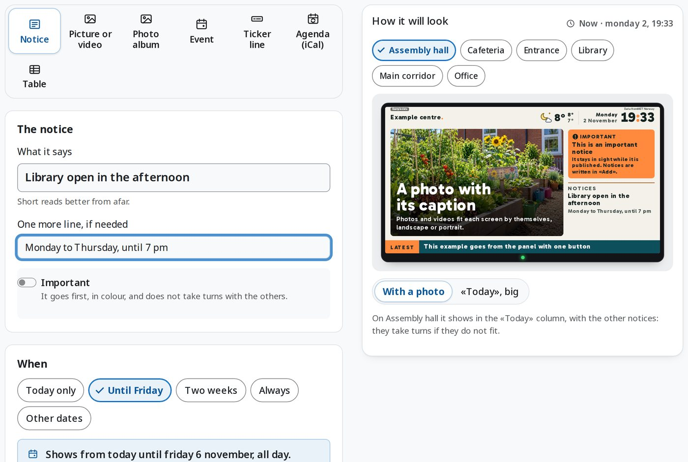

- **Notice.** A short title and one more line if needed. If it is **important**, it stays in sight on all its screens
  while it is published.
- **Picture or video.** It fits each screen by itself, landscape or portrait. In **How it comes out** you choose:
  automatic (it crops a little to fill the space), whole or full screen. Videos are prepared on the server so that they
  play well on any screen.
- **Photo album.** Several photos that come out one at a time, without pushing everything else out.
- **Event.** With its day and its time; it comes out on that day and in the agenda of the days before. Its category gives
  it a colour.
- **Ticker line.** A short sentence for the strip at the bottom.
- **Agenda (iCal).** The address of a calendar (Google Calendar, Outlook, Nextcloud…). Its events come out by themselves
  and are read again every few minutes.
- **Table.** The address of a spreadsheet published as CSV (Google Sheets, OneDrive, Nextcloud) or of a list in JSON:
  timetables, shifts, rooms, results. It has its own slide, by pages. Put the important columns first: from afar they
  may not all fit. There is a model to download in the same form.

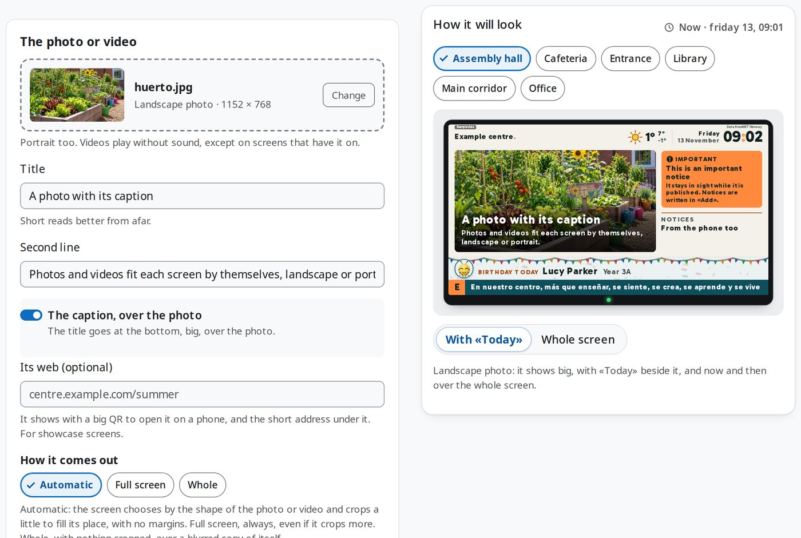

### When and where

Each thing comes out **when** you say: from now on or between two dates, on some days of the week, at some hours, every
week or every few weeks. And **where**: on all the screens, in one or several groups, or on single screens.

A notice can also be published **in the site news**: once, when it is saved, and Moodle sends it by email or to the phone
of whoever follows that forum.

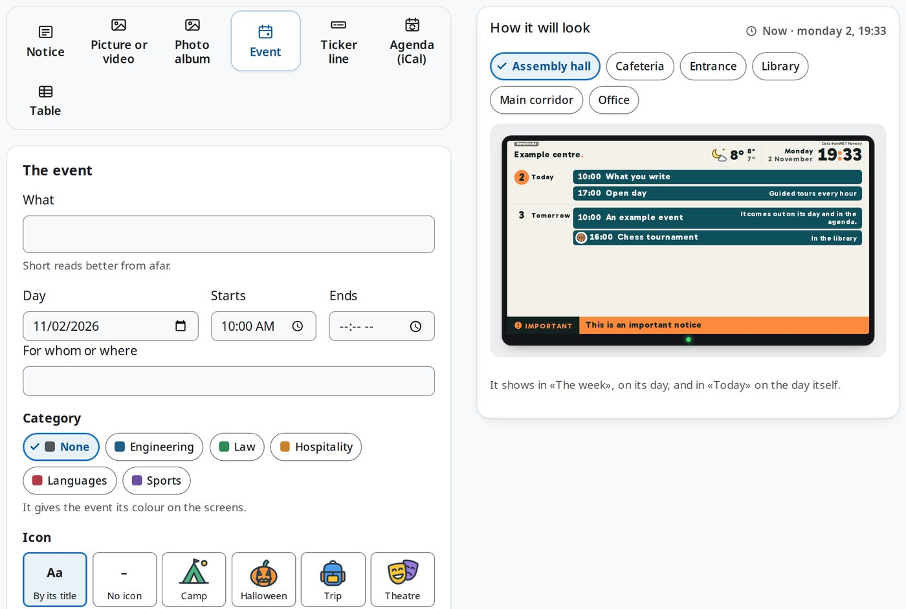

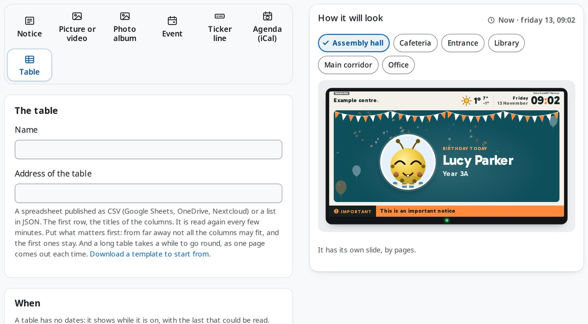

## The urgent notice

For what cannot wait (a drill, a closure, a last-minute change), **Urgent notice** takes the whole screen at once and
stays until you take it off, for an hour or until the end of the day. It can go to all the screens or only to some.
Screens switched off by their hours show it when they come on, if it is still up.

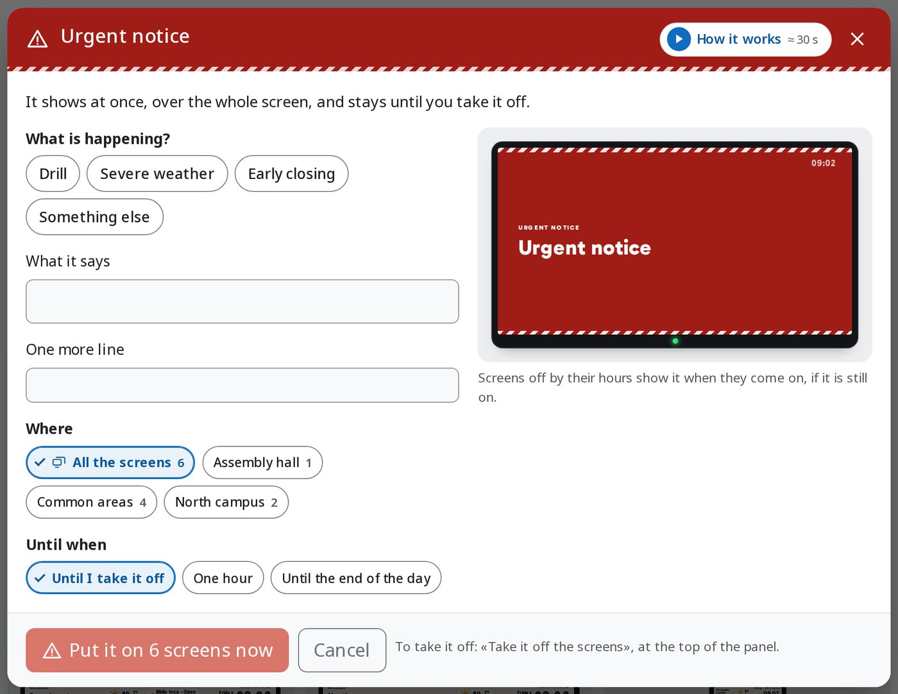

## What comes by itself

The screens do not wait for someone to publish. Without typing anything, they show:

- **The site calendar** and, on the screens of a group tied to a course category, its events too.
- **The site news.**
- **The menu of the day**, with its allergens, if the centre uses Oksigenia Meals.
- **What is new in the library**, if the centre uses Oksigenia Ayvurenda.
- **The assignments and quizzes** due in the coming days.
- **The birthdays**, if they are switched on.
- **The weather** where the centre is.

Each source is switched on or off in «Get started».

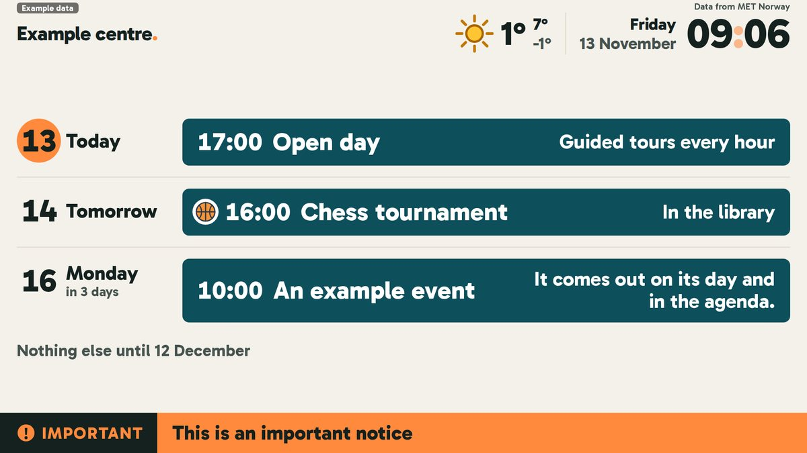

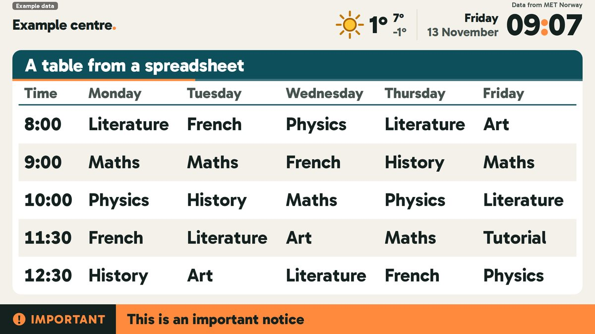

## Birthdays

In **Your centre → Manage birthdays**. The screens congratulate whoever has a birthday, with their name, their group and
their photo. Never the age, and never on a showcase screen. Off by default.

- Whoever is in Moodle comes out with the date of a profile field, if the site has one, and with their profile picture.
- For everyone else there is a **list**: one at a time, pasting a list or **uploading a spreadsheet** with the columns
  of the model you download right there (name, group, day, month and, if any, the ID number in Moodle).
- **The photos** are uploaded all at once: each file with the name of the person («Lucy Parker.jpg») or with their ID
  number («1024.jpg»). In many centres, the ID number in Moodle is the enrolment number.

The day and the month are kept, never the year.

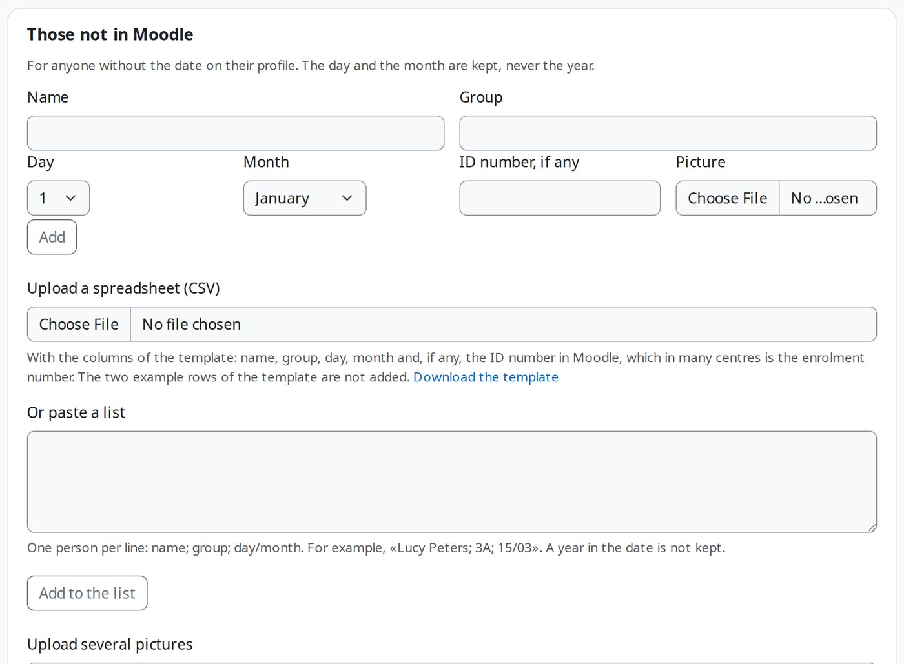

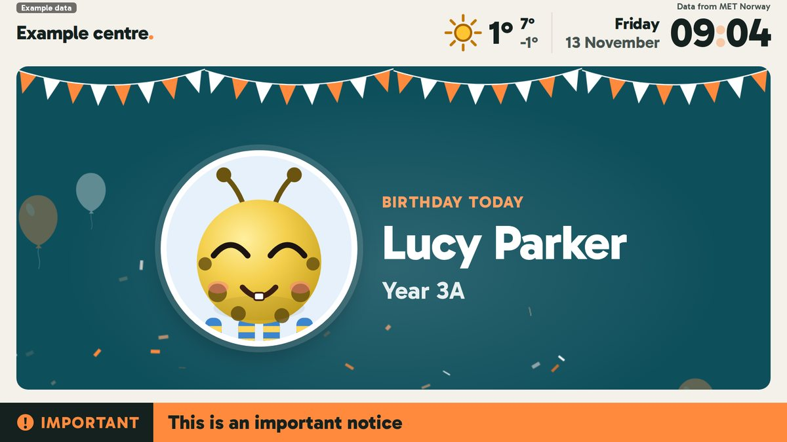

## Screens and groups

Here are all the screens, with their state, and the groups.

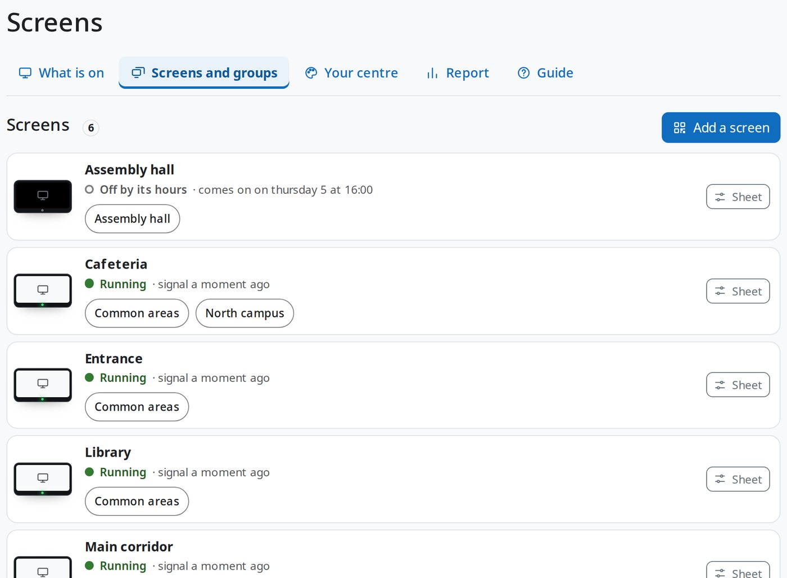

A **group** puts screens together to publish on all of them at once: those of a floor, of a building, of the cafeteria.
A screen can be in several groups. Each group can:

- **be tied to a course category** in Moodle (a faculty, a stage, a department), so that its screens also show the
  events and deadlines of that category;
- **be a site**, if its screens are somewhere else;
- have **someone who publishes on it**, and only on it.

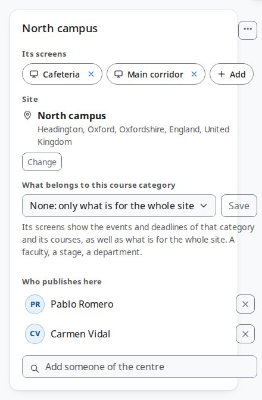

### Sites

A campus, a branch or a camp in another town: a group can have **its own name, its place (and with it its weather) and
its logo**. Its screens take them instead of the centre's; everything else, as the centre. It opens from the group's
card, with **Is it somewhere else?**

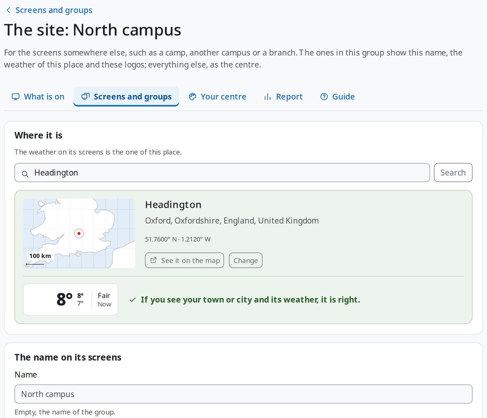

### Who does what

Nobody needs to be a Moodle administrator to run the screens. Everything is handed out in **Screens and groups**, with a
people search:

- **Run the screens**: they add the screens, their hours and their groups, decide who publishes where and get the
  warnings when a screen goes down. The site administrator chooses them.
- **Publish everywhere**: on any screen, and they can change or take off what others published. The office or the
  management, for example.
- **Publish in a group**: only on the screens of that group, and they only see those screens and what they publish
  themselves. For example, whoever runs a club, a department or a site.

Giving a permission tells nobody. When you want the person to know, the envelope beside their name sends them a notice
from you, with the panel and this guide.

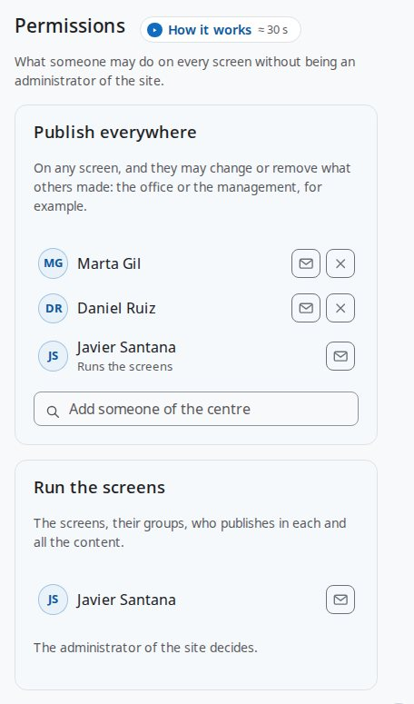

## Each screen's sheet

Each screen has its sheet, with what it shows now (and a capture of what it really shows, if it has the Hechauka device),
its state, its name and its groups, and:

- **What it is for.** Informative (what is on at the centre, with the fixed notice and the ticker), **showcase** (large
  photos and videos, for the street or an entrance) or mixed. It can change at some hours.
- **Where it is read from.** Close (about 3 m), middle distance (about 5 m) or from afar (8 m or more), and whether it is
  behind glass. The size of the letter and how much fits at once change by themselves.
- **Its hours.** Outside them, the screen switches off by itself if the device can, and it does not count as down.
- **Reload**, if it is ever needed.

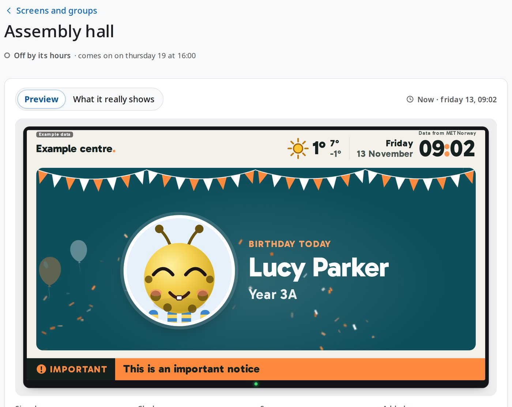

## Your centre

What makes the screens the centre's, and not Hechauka's:

- **Where it is**, for the weather.
- **The logo**, one for a light background and one for a dark one.
- **The skin**: the colours and the letter of all the screens. There are several, and **Customise** adapts any of them to
  your centre (colours, background, letter and corners), always with tested combinations that read from afar.
- **The colours of the centre** and the **theme**, light, dark or by the hour.
- **The categories**, up to six, to colour the events by whom they are for, or brought from the course categories.
- **The day**: at what time the screens start showing tomorrow.
- **The surprises**: now and then, a character crosses the screen. Off by default.

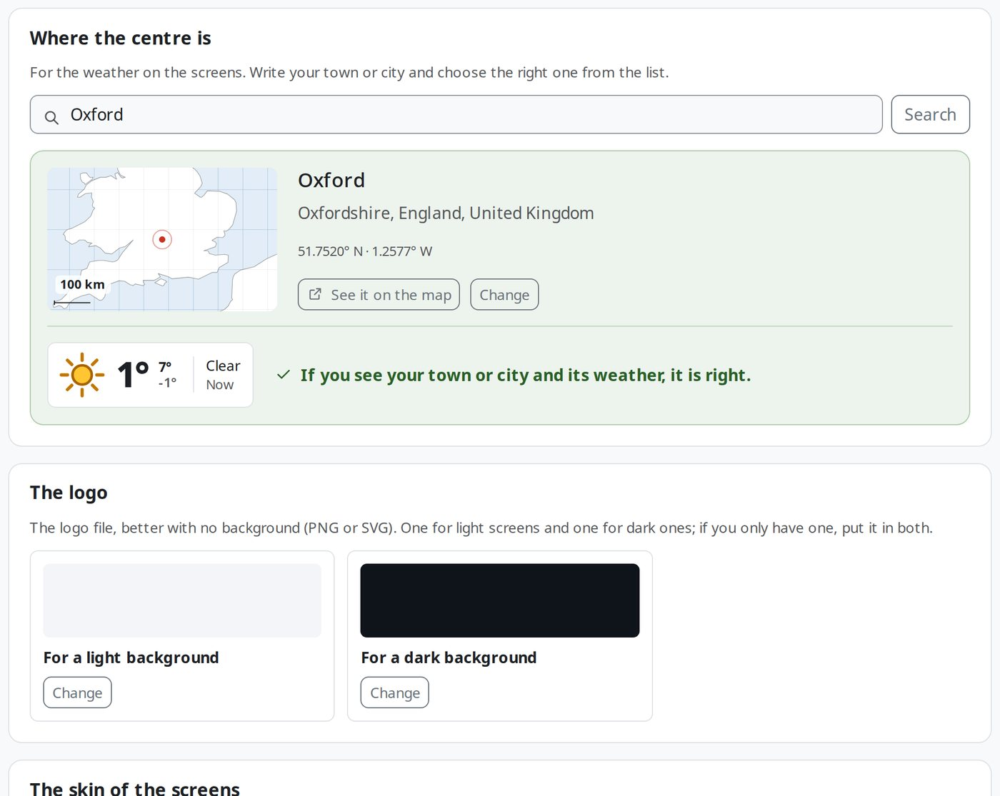

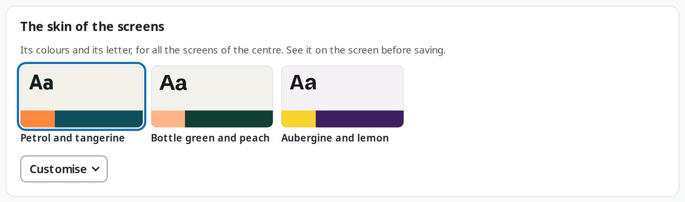

## The monthly report

The **Report** tab says, month by month, how much of its hours each screen was running, day by day; its longest cuts;
and what came out and how many times. The first sentence names the screen that failed most. It can be downloaded as CSV
or printed, and on the 1st of each month a message reaches whoever runs the screens.

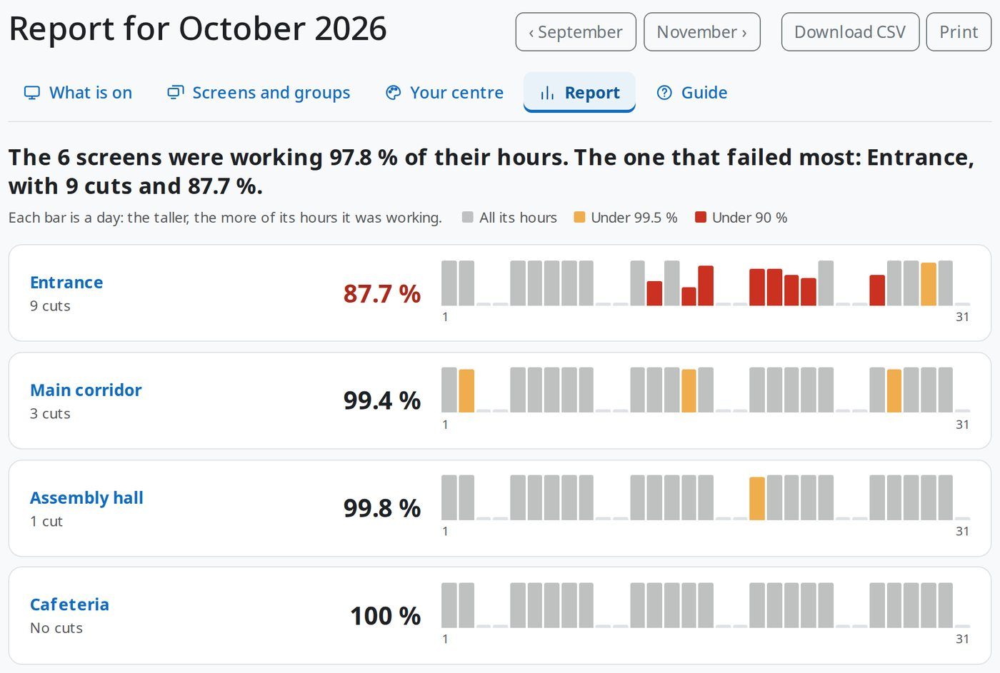

## If something does not work

- **A screen with «no signal».** Check that it is on and connected to the internet. If a screen that should be on stops
  giving signs of life, whoever runs the screens gets a warning, and another when it comes back.
- **Something published does not come out.** Check in its row **when** and **where** it comes out, and that it is
  published and not just saved. The preview of each screen shows what it has now.
- **A video takes a while.** It is prepared on the server before reaching the screens; meanwhile, it does not come out.
- **An agenda or a table cannot be read.** The address has to be published, without asking to sign in. The panel says
  when it was last read.

Without a network for a while, a screen goes on showing the last thing it received.

## For whoever installs it

- The plugin is installed like any other Moodle plugin. The technical settings (among them, the tool that prepares the
  videos, `ffmpeg`) are in the site administration.
- For each screen a modern browser in kiosk mode is enough. With the Hechauka device (a Raspberry Pi or a mini computer),
  the television also switches on and off with its hours, you can see what it really shows, and it recovers by itself if
  something hangs.
- The technical details and the guide for each centre's developers are in the plugin's repository. Oksigenia Hechauka
  is free software (GNU GPL v3), by Oksigenia SL: oksigenia.com.
