

# Guía de uso

Las pantallas informativas de tu centro, llevadas desde Moodle.

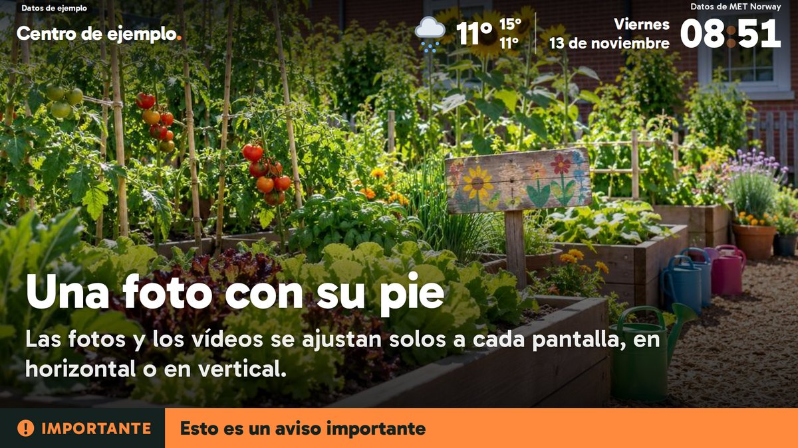

Para quien lleva las pantallas y para quien publica en ellas. Con un centro de ejemplo y datos de ejemplo.<b>oksigenia.com</b>

## Qué es Hechauka

Hechauka lleva las pantallas informativas de un centro desde su Moodle: avisos, fotos, vídeos, eventos, el menú del día, la
agenda, el tiempo y lo que haga falta. Cada pantalla lo enseña de forma que se lee de lejos, y se llena sola con lo que
Moodle ya sabe, aunque nadie publique nada.

Esta guía es para quien lleva las pantallas y para quien publica en ellas. Todas las imágenes son de un centro de ejemplo,
con datos de ejemplo.

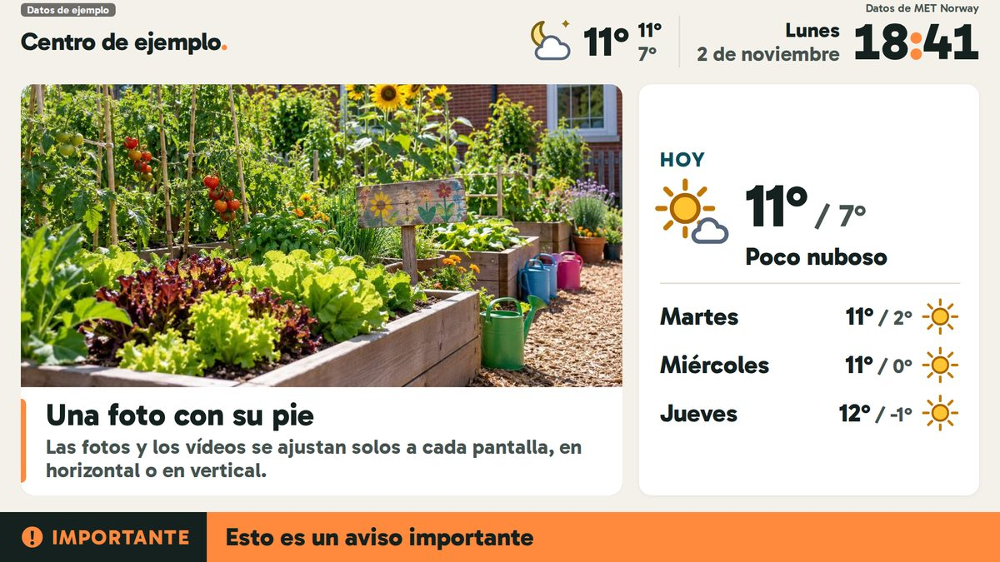

Hechauka sirve igual para un colegio, una universidad, una academia, un ayuntamiento o una empresa: lo que cambia es lo
que cada uno publica.

## Lo que hace falta

- **Un Moodle** de la versión 4.5 o posterior, con el plugin instalado. Lo instala quien administra el Moodle.
- **Una pantalla con internet.** Vale una tele o un monitor con navegador, o cualquiera con un aparato pequeño conectado (un
  miniordenador o una Raspberry Pi). La pantalla no tiene que estar en la misma red que el Moodle: basta con que llegue a
  él por internet. Por eso un centro con varios edificios, o con un campamento en otro pueblo, lo lleva todo desde el
  mismo Moodle.
- **Alguien que lleve las pantallas.** No tiene que ser administrador de Moodle: el plugin trae sus propios permisos
  (más abajo, en [Quién hace qué](#permisos)).

## La primera vez

La primera vez que entras en «Pantallas», el panel te recibe con **Empezar**: cinco pasos con la pantalla a la vista,
que cambia según eliges.

1. **Qué es tu centro.** Un colegio, una universidad, una academia, una administración, una empresa u otra cosa. No cambia
   lo que puedes hacer; solo lo que se te propone para empezar.
2. **Tu marca.** El nombre, el logotipo y los colores se toman de tu Moodle. Puedes cambiarlos.
3. **Lo que llega solo.** Qué fuentes de tu Moodle salen en las pantallas: el calendario, las noticias, el menú, la
   biblioteca, las entregas. Cada una dice lo que trae ahora mismo.
4. **Dónde está el centro.** Para el tiempo de las pantallas.
5. **La primera pantalla.** La dirección que hay que abrir en la pantalla.

Lo que tocas se guarda solo. Puedes dejarlo a medias: el panel te recuerda lo que falta.

### El ejemplo

Un Moodle donde se acaba de instalar Hechauka trae un **ejemplo**: un aviso importante, avisos, fotos, un evento, una tabla
y la cinta, y cada pieza explica lo que hace. Así ni el panel ni la primera pantalla empiezan vacíos. Mientras quede algo
del ejemplo, las pantallas lo dicen con una etiqueta pequeña, «Datos de ejemplo».

Cuando empieces con lo tuyo, pulsa **Quitar el ejemplo** en el panel. Si cambias una pieza del ejemplo, se queda como tuya.

## Poner una pantalla

1. Abre en la pantalla la dirección que da el panel (en «Empezar» o en «Pantallas y grupos», con **Añadir una
   pantalla**). La pantalla enseña un código y un QR.
2. Escanea el QR con el móvil, o abre en el móvil la dirección que sale y escribe el código.
3. Dile si **es nueva** o **sustituye a otra** (si has cambiado la tele o el aparato, se queda con el nombre, los grupos y
   lo que enseñaba la anterior). Ponle un nombre que diga dónde está y, si quieres, sus grupos.

En unos segundos la pantalla empieza a enseñar lo suyo. El código cambia cada pocos minutos: usa siempre el que se ve.

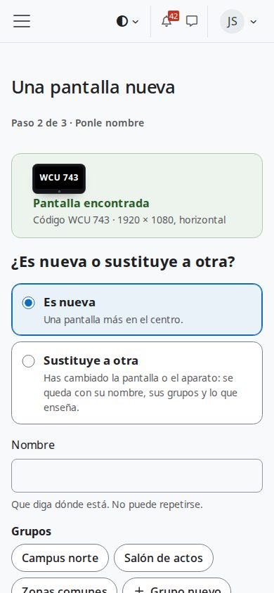

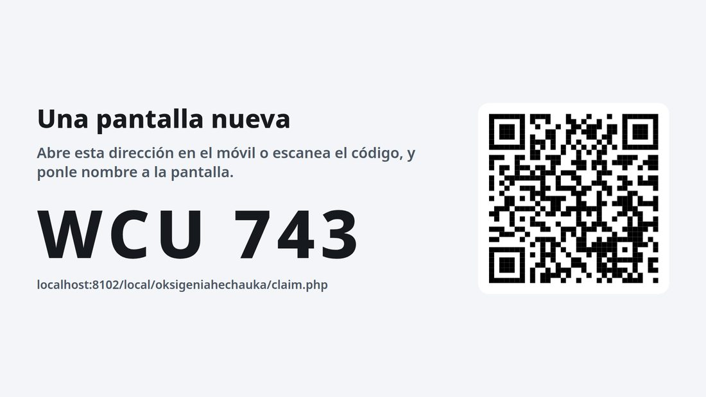

## Lo que sale

La primera pestaña del panel enseña cada pantalla con lo que tiene ahora, si está en marcha y, debajo, todo lo publicado:
cuándo sale y dónde. Desde ahí se cambia, se oculta, se duplica o se quita cada cosa.

En el móvil, el mismo panel cabe en una columna.

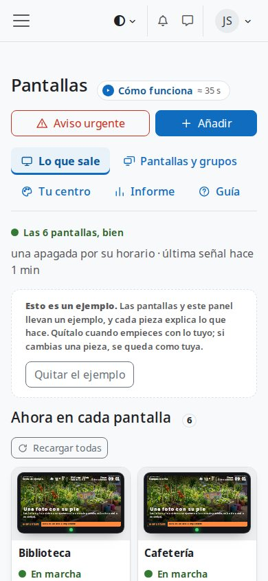

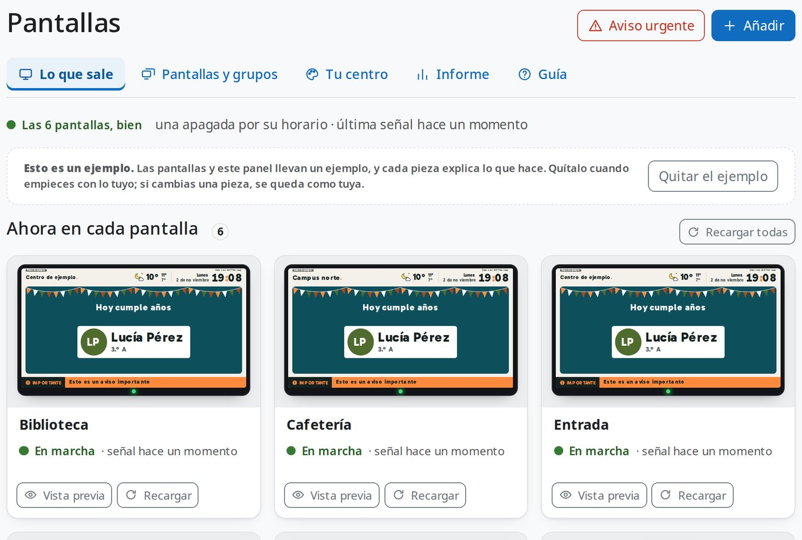

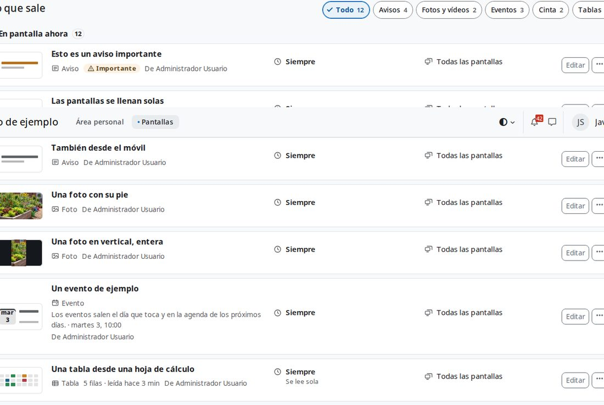

## Añadir

**Añadir** abre un formulario con la pantalla al lado: según escribes, ves cómo saldrá. Arriba eliges el tipo de
contenido.

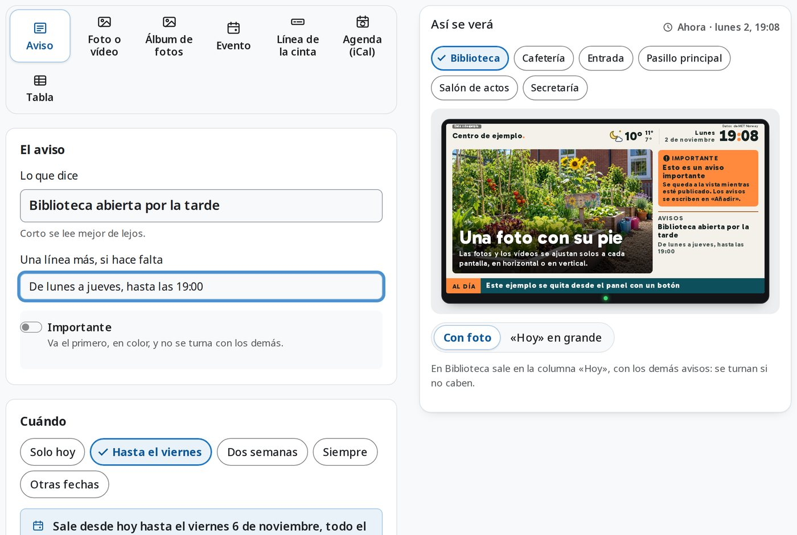

- **Aviso.** Un título corto y una línea más si hace falta. Si es **importante**, se queda a la vista en todas sus
  pantallas mientras esté publicado.
- **Foto o vídeo.** Se ajusta solo a cada pantalla, horizontal o vertical. En **Cómo sale** eliges: automático (recorta un
  poco para llenar el hueco), entera o a pantalla completa. Los vídeos se preparan en el servidor para que vayan bien en
  cualquier pantalla.
- **Álbum de fotos.** Varias fotos que salen de una en una, sin echar a lo demás.
- **Evento.** Con su día y su hora; sale ese día y en la agenda de los días anteriores. La categoría le da color.
- **Línea de la cinta.** Una frase corta para la franja de abajo.
- **Agenda (iCal).** La dirección de un calendario (Google Calendar, Outlook, Nextcloud…). Sus eventos salen solos y se
  vuelven a leer cada pocos minutos.
- **Tabla.** La dirección de una hoja de cálculo publicada como CSV (Google Sheets, OneDrive, Nextcloud) o de una lista en
  JSON: horarios, turnos, aulas, resultados. Sale en su propia diapositiva, por páginas. Pon delante las columnas
  importantes: de lejos pueden no caber todas. Hay un modelo para descargar en el mismo formulario.

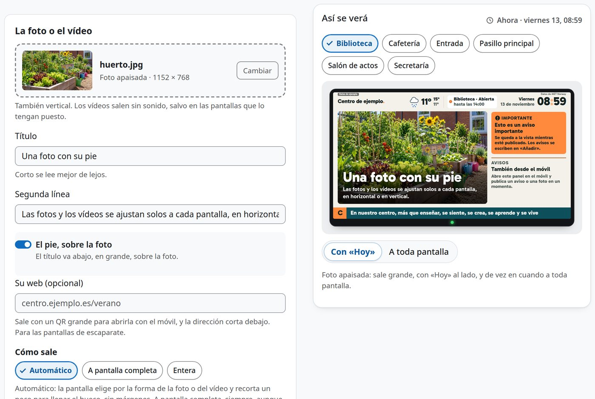

### Cuándo y dónde

Cada cosa sale **cuándo** tú digas: desde ya o entre dos fechas, ciertos días de la semana, a ciertas horas, cada una o
varias semanas. Y **dónde**: en todas las pantallas, en uno o varios grupos, o en pantallas sueltas.

Un aviso puede publicarse **también en las noticias del sitio**: una vez, al guardarlo, y Moodle lo envía por correo o al
móvil a quien sigue ese foro.

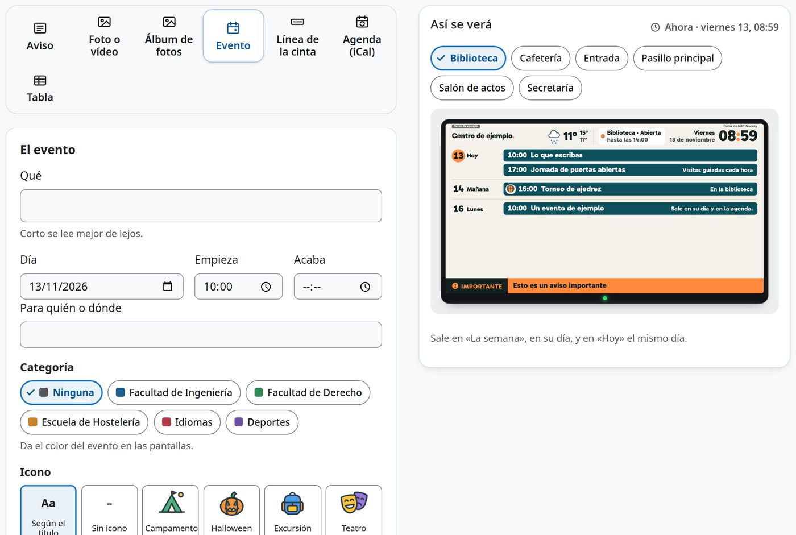

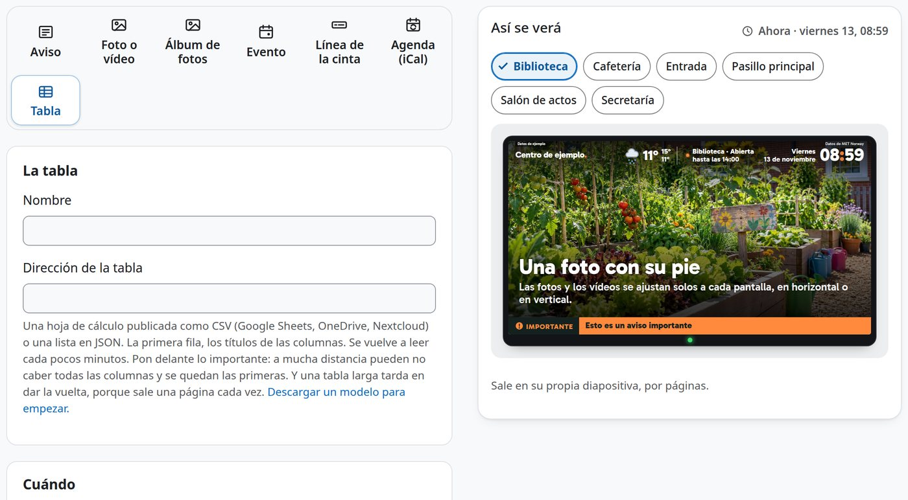

## El aviso urgente

Para lo que no puede esperar (un simulacro, un cierre, un cambio de última hora), **Aviso urgente** ocupa la pantalla
entera en seguida y se queda hasta que lo quites, una hora o hasta el final del día. Puede ir a todas las pantallas o
solo a algunas. Las pantallas apagadas por su horario lo enseñan al encenderse, si sigue puesto.

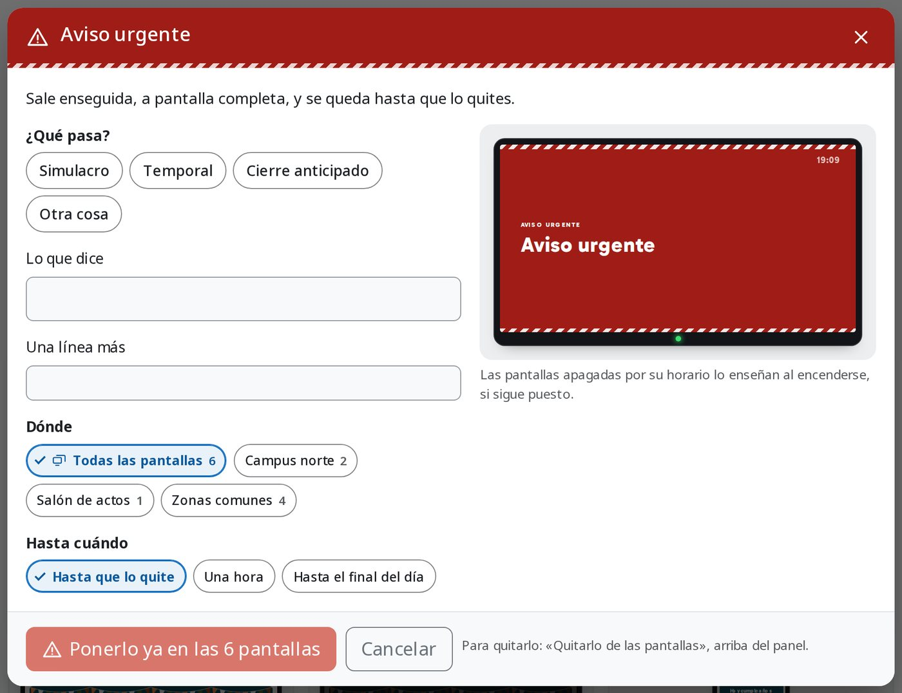

## Lo que llega solo

Las pantallas no esperan a que alguien publique. Sin teclear nada, enseñan:

- **El calendario del sitio** y, en las pantallas de un grupo atado a una categoría de cursos, también sus eventos.
- **Las noticias del sitio.**
- **El menú del día**, con sus alérgenos, si el centro usa Oksigenia Meals. Con varios menús, una diapositiva los enseña
  todos, cada uno con su letra en grande, y sale a menudo en las horas del comedor.
- **Las novedades de la biblioteca**, si el centro usa Oksigenia Ayvurenda.
- **Lo que celebra la biblioteca** esa semana, con Ayvurenda y sin nombres de nadie: los libros prestados en el curso, un libro
  que llega a sus cien salidas, el día con más préstamos o los lectores que llegan a la meta de un reto.
- **Las entregas y los cuestionarios** de los próximos días.
- **Los cumpleaños**, si se encienden.
- **El tiempo** de donde está el centro.

Cada fuente se enciende o se apaga en «Empezar».

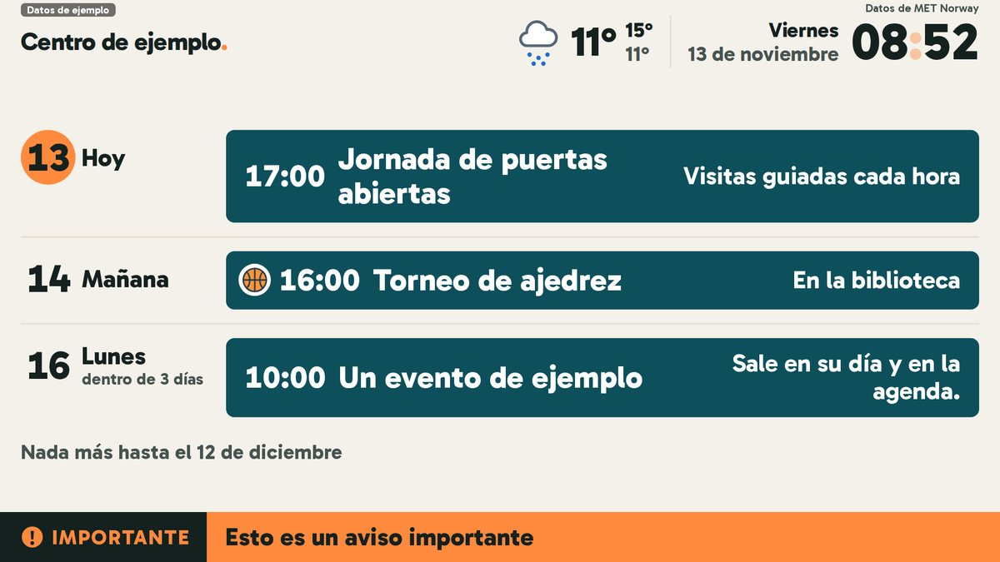

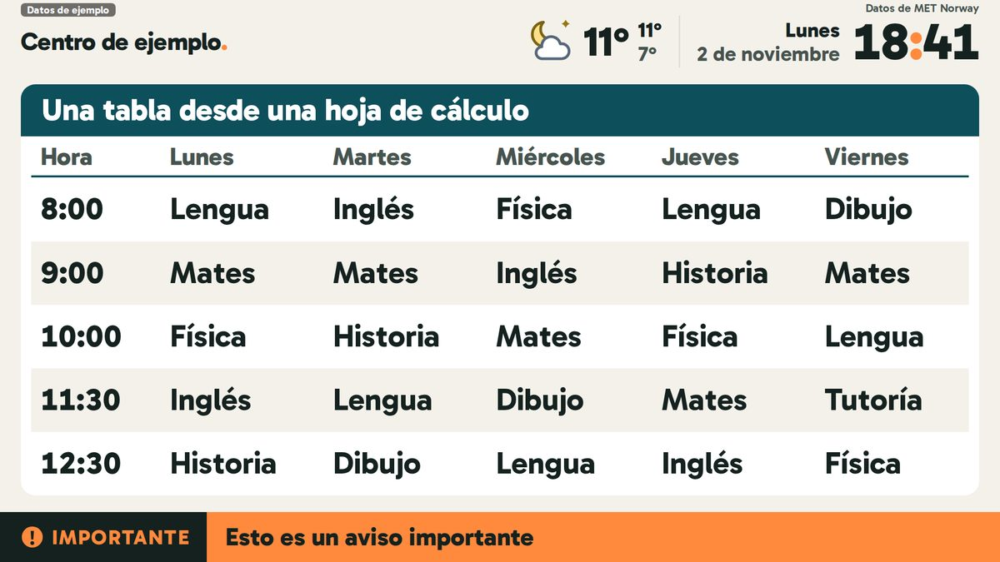

## Los cumpleaños

En **Tu centro → Llevar los cumpleaños**. Las pantallas felicitan a quien cumple años, con su nombre, su grupo y su foto.
Nunca la edad, y nunca en una pantalla de escaparate. De serie, apagados.

- Quien está en Moodle sale con la fecha de un campo del perfil, si el sitio lo tiene, y con su foto de perfil.
- Para los demás hay una **lista**: de uno en uno, pegando una lista o **subiendo una hoja de cálculo** con las columnas
  del modelo que se descarga ahí mismo (nombre, grupo, día, mes y, si lo tiene, el número de ID de Moodle).
- **Las fotos** se suben de una vez: cada archivo con el nombre de la persona («Lucía Pérez.jpg») o con su número de ID
  («1024.jpg»). En muchos centros, el número de ID de Moodle es el de matrícula.

El día en que alguien cumple años, además de su turno de fiesta, una franja lo felicita durante todo el día debajo de lo
que esté saliendo, de uno en uno si son varios.

Se guardan el día y el mes, nunca el año.

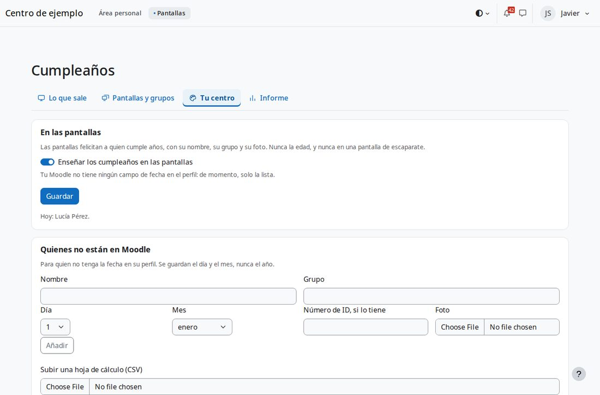

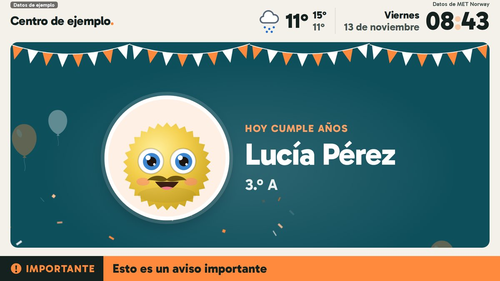

## Pantallas y grupos

Aquí están todas las pantallas, con su estado, y los grupos.

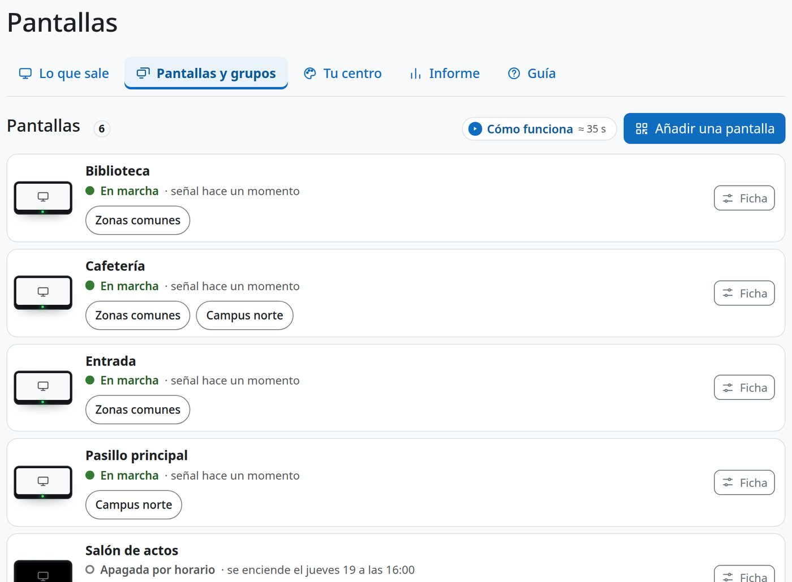

Un **grupo** junta pantallas para publicar en todas a la vez: las de una planta, las de un edificio, las de la cafetería.
Una pantalla puede estar en varios grupos. Cada grupo puede:

- **atarse a una categoría de cursos** de Moodle (una facultad, una etapa, un departamento), para que sus pantallas
  enseñen también los eventos y las entregas de esa categoría;
- **ser una sede**, si sus pantallas están en otro sitio;
- tener **quien publica en él**, y solo en él.

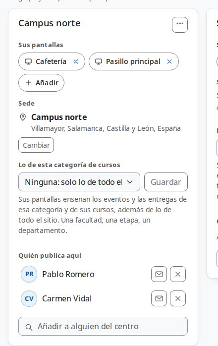

### Las sedes

Un campus, una delegación o un campamento en otro pueblo: un grupo puede tener **su propio nombre, su lugar (y con él su
tiempo) y su logotipo**. Sus pantallas los toman en lugar de los del centro; lo demás, como el centro. Se abre desde la
tarjeta del grupo, con **¿Está en otro sitio?**

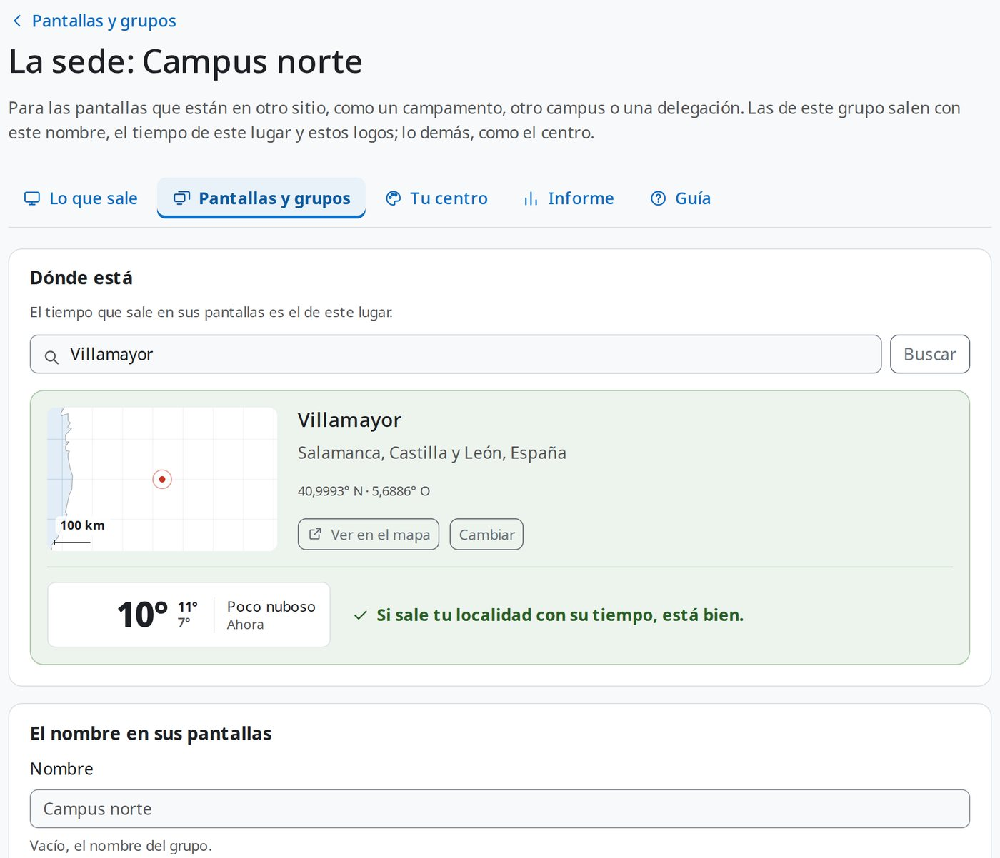

### Quién hace qué

Nadie tiene que ser administrador de Moodle para llevar las pantallas. Todo se reparte en **Pantallas y grupos**, con un
buscador de personas:

- **Llevan las pantallas**: dan de alta las pantallas, sus horarios y sus grupos, deciden quién publica dónde y reciben
  los avisos de pantalla caída. Los elige el administrador del sitio.
- **Publican en todas**: en cualquier pantalla, y pueden cambiar o quitar lo de los demás. La secretaría o la dirección,
  por ejemplo.
- **Publican en un grupo**: solo en las pantallas de ese grupo, y solo ven esas pantallas y lo que publican ellos. Por
  ejemplo, quien lleva un club, un departamento o una sede.

Dar un permiso no avisa a nadie. Cuando quieras que esa persona lo sepa, el sobre junto a su nombre le manda un aviso de
tu parte, con el panel y esta guía.

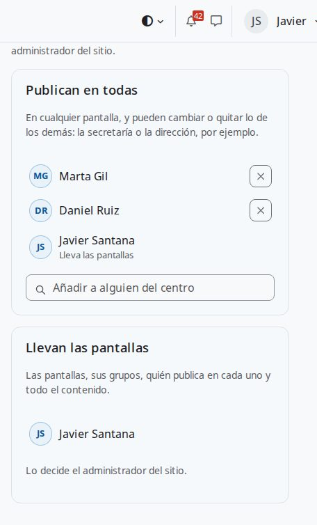

## La ficha de cada pantalla

Cada pantalla tiene su ficha, con lo que enseña ahora (y una captura de lo que se ve de verdad, si tiene el aparato de
Hechauka), su estado, su nombre y sus grupos, y:

- **Para qué es.** Informativa (lo del centro, con el aviso fijo y la cinta), de **escaparate** (fotos y vídeos grandes,
  para la calle o una entrada) o mixta. Puede cambiar a ciertas horas.
- **Desde dónde se lee.** De cerca (unos 3 m), a media distancia (unos 5 m) o de lejos (8 m o más), y si está tras un
  cristal. La letra y lo que cabe a la vez cambian solos.
- **Su horario de encendido.** Fuera de él, la pantalla se apaga sola si el aparato puede, y no cuenta como caída.
- **Su sitio y su horario.** Si está en un sitio con horario (la biblioteca, el comedor), la pantalla dice junto a la hora
  si está abierto y hasta cuándo, o cuándo abre, y de vez en cuando enseña el horario de la semana. Los días que cierra,
  como los festivos, se apuntan aparte.
- **Recargar**, si alguna vez hace falta.

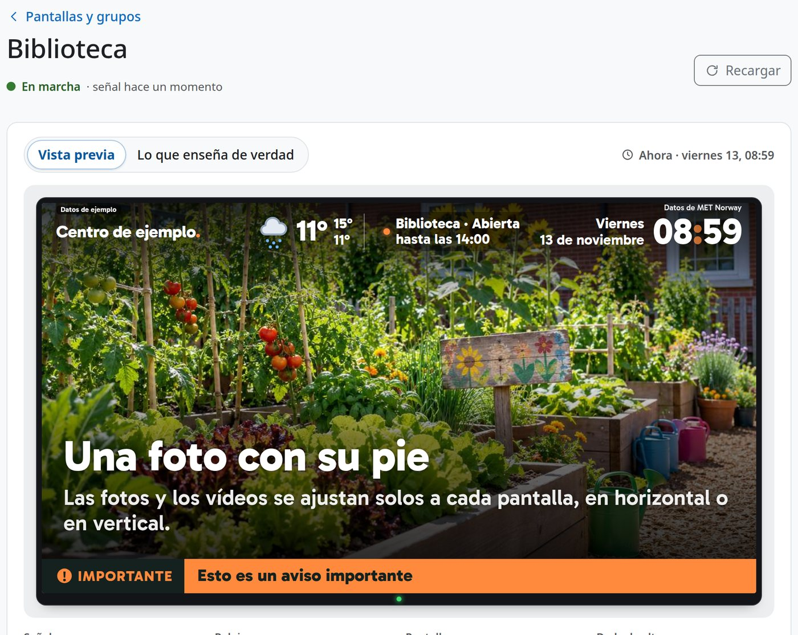

## Tu centro

Lo que hace que las pantallas sean las del centro, y no las de Hechauka:

- **Dónde está**, para el tiempo.
- **El logotipo**, uno para fondo claro y otro para oscuro.
- **La piel**: los colores y la letra de todas las pantallas. Hay varias, y con **Personalizar** se adapta cualquiera a tu
  centro (colores, fondo, letra y esquinas), siempre con combinaciones probadas que se leen de lejos.
- **Los colores del centro** y el **tema**, claro, oscuro o según la hora.
- **Las categorías**, hasta seis, para dar color a los eventos según a quién van, o traídas de las categorías de cursos.
- **La jornada**: a qué hora pasan las pantallas a enseñar lo de mañana; con Oksigenia Meals, a qué horas sirve el
  comedor; y cuántos vídeos salen al día en cada pantalla (de serie, dos): si hay más, se turnan, cada día otros.
- **La frase del centro**: su lema, entero en la cinta cada pocas frases y con el logotipo.
- **Las sorpresas**: de vez en cuando, un personaje cruza la pantalla. De serie, apagadas.

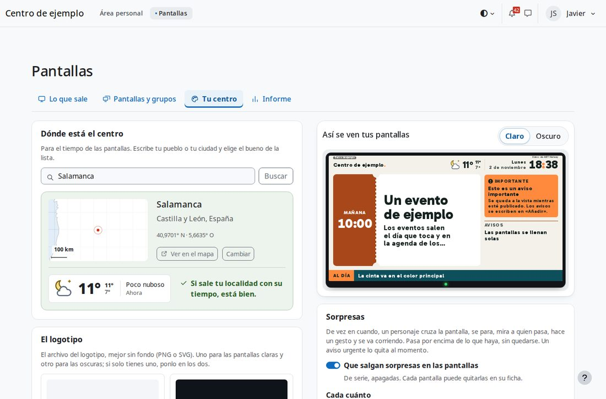

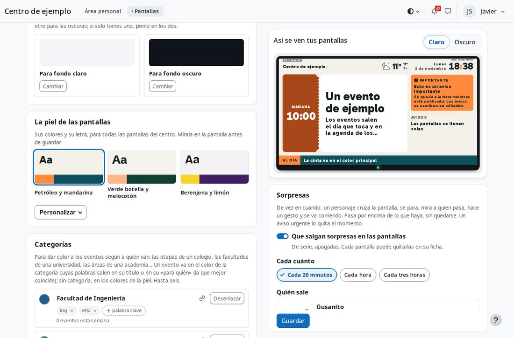

## El informe mensual

La pestaña **Informe** dice, mes a mes, cuánto de su horario ha estado en marcha cada pantalla, día a día; sus cortes
más largos; y lo que ha salido y cuántas veces. La primera frase nombra a la pantalla que más ha fallado. Se puede
descargar en CSV o imprimir, y el día 1 de cada mes llega un mensaje a quien lleva las pantallas.

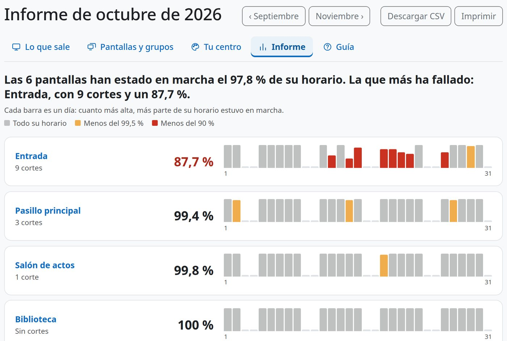

## Si algo no va

- **Una pantalla «sin señal».** Mira que esté encendida y con internet. Si una pantalla que debería estar encendida deja
  de dar señales, quien lleva las pantallas recibe un aviso, y otro cuando vuelve.
- **No sale algo publicado.** Mira en su fila **cuándo** y **dónde** sale, y que esté publicado y no guardado sin
  publicar. La vista previa de cada pantalla enseña lo que tiene ahora.
- **Un vídeo tarda.** Se prepara en el servidor antes de llegar a las pantallas; mientras tanto, no sale.
- **Una agenda o una tabla no se leen.** La dirección tiene que estar publicada, sin pedir que se inicie sesión. El panel
  dice cuándo se leyó por última vez.

Si la pantalla no tiene red un rato, sigue enseñando lo último que recibió.

## Para quien instala

- El plugin se instala como cualquier otro de Moodle. Los ajustes técnicos (entre ellos, la herramienta que prepara los
  vídeos, `ffmpeg`) están en la administración del sitio.
- Para cada pantalla basta un navegador moderno en modo quiosco. Con el aparato de Hechauka (una Raspberry Pi o un
  miniordenador), además, la tele se enciende y se apaga con su horario, se ve lo que enseña de verdad y se recupera sola
  si algo se queda colgado.
- Todo lo técnico, el contrato entre las pantallas y el servidor y la guía para los desarrolladores de cada centro están
  en el repositorio del plugin.

Oksigenia Hechauka es software libre (GNU GPL v3), de Oksigenia SL: oksigenia.com.
